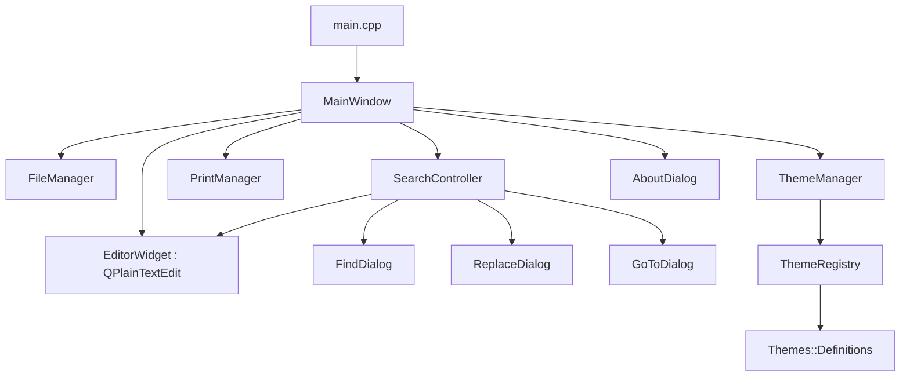

# YANP Architecture Documentation

## Overview

**YANP (Yet Another Notepad)** is a cross-platform desktop text editor written in **C++20** and built on **Qt 6 Widgets**. It is inspired by Dave Plummer's **TinyRetroPad** (https://github.com/plummersSoftwareLLC/TinyRetroPad).

YANP preserves the classic, distraction-free simplicity of Notepad while providing a modern, maintainable C++ architecture and a maintainer-curated theme system.

---

## Component Diagram

---

## Core Components

### 1. `MainWindow`
- Central coordinator of the application.
- Owns top-level native menus (File, Edit, Format, View, Help).
- Manages application lifetime, unsaved change warnings, and window title updating (`*filename - YANP`).
- Restores and persists user preferences (geometry, font, word wrap, status bar visibility) via `QSettings`.

### 2. `EditorWidget`
- Subclass of `QPlainTextEdit`.
- Directly handles text input, cursor tracking, line and column index calculation (1-indexed).
- Supports horizontal scrollbar toggle via `setWordWrapEnabled(bool)`.
- Re-implements `dragEnterEvent` and `dropEvent` to support native drag-and-drop of text files directly into the editor.
- Implements `insertDateTime()` (F5) and `deleteSelection()` (Del).

### 3. `FileManager`
- Encapsulates all file I/O operations and state outside the UI.
- Detects and preserves character encodings:
  - UTF-8
  - UTF-8 with BOM (Byte Order Mark `\xEF\xBB\xBF`)
  - UTF-16 LE (`\xFF\xFE`)
  - UTF-16 BE (`\xFE\xFF`)
  - System Locale fallback
- Detects line endings (Windows CRLF vs Unix LF) and preserves them when saving.
- Employs atomic write operations via `QSaveFile`, preventing file truncation or data loss on failed write attempts.

### 4. `SearchController`
- Decouples search logic from the UI.
- Manages non-modal `FindDialog`, `ReplaceDialog`, and modal `GoToDialog`.
- Implements wrap-around forward/backward search, case-sensitivity flags, single replace, and document-wide `replaceAll`.
- Jump-to-line navigation with range validation.

### 5. `PrintManager`
- Uses `QtPrintSupport` (`QPrinter`, `QPrintDialog`, `QPageSetupDialog`).
- Provides native page setup and paginated document printing via `QTextDocument::print()`.
- Does not modify document state during printing.

### 6. `ThemeRegistry` & `ThemeManager`
- **Theme Definition:** Strongly-typed `Theme` struct with stable identifier, human-readable display name, colors for editor, window, status bar, and selection.
- **Theme Registry:** Central singleton containing all maintainer-shipped themes. Rejects invalid themes or duplicate IDs.
- **Theme Application:** Seamless application using Qt widget palettes and focused QSS stylesheet properties.
- **Persistence:** Selected theme ID persisted via `QSettings` under `theme/id`, with fallback to `system-default`.

---

## Design Principles
1. **Separation of Concerns:** Business logic (file operations, search logic, theme registry) is decoupled from GUI presentation widgets.
2. **Minimal Resource Overhead:** Avoids heavy frameworks, background daemon processes, web runtimes, or unneeded threads.
3. **Robust Error Handling:** File I/O and user inputs validate edge cases, report descriptive messages, and prevent data corruption.
